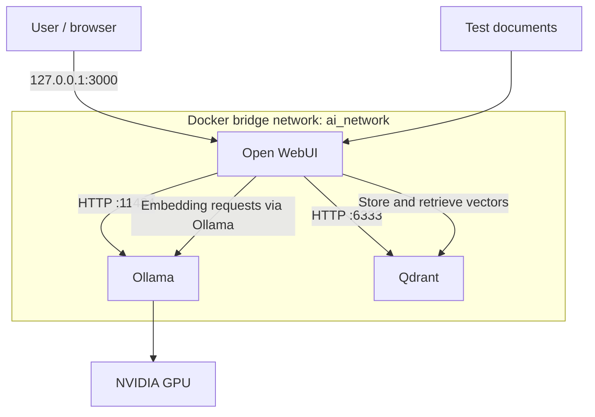

# Local AI Security Lab

A self-hosted AI environment built to explore Linux infrastructure, containerisation, GPU-accelerated inference and retrieval-augmented generation (RAG) in a cybersecurity learning context.

The initial implementation runs on Kali Linux with Docker Compose, Ollama, Open WebUI and Qdrant. It was deployed and functionally tested in a local lab; it has **not** undergone a comprehensive security assessment or formal performance benchmarking.

## Project Status

**Initial deployment: completed and verified.** Further hardening, adversarial RAG testing, repeatable benchmarks and full backup/restore testing remain planned work. The original lab configuration and detailed installation notes are retained privately while a reviewed, reproducible public deployment guide is prepared.

## Objectives

- Run language models locally without relying on external inference APIs.
- Enable NVIDIA GPU acceleration for inference in containers.
- Build a RAG workflow using document embeddings and a vector database.
- Limit unnecessary host port exposure and manage application secrets separately.
- Validate the platform with reproducible functional checks and recorded evidence.

## Technology Stack

| Layer | Technology |
|---|---|
| Host operating system | Kali GNU/Linux 2026.3 |
| Container platform | Docker Engine and Docker Compose |
| GPU integration | NVIDIA Container Toolkit |
| Hardware | NVIDIA GeForce RTX 5060 Ti (16 GB VRAM) |
| Local inference | Ollama |
| Web interface and RAG orchestration | Open WebUI |
| Vector database | Qdrant |
| Language models tested | `qwen3.5:9b`, `gemma4:12b` |
| Embedding model | `embeddinggemma-2:740m` |

## Architecture

Open WebUI provides the browser interface and coordinates document processing and retrieval. Ollama runs both language and embedding models using the NVIDIA GPU. Qdrant stores the resulting vectors. The embedding model is a model served by Ollama, **not** a separate container.

### Network and storage

| Service | Container port | Published on host |
|---|---|---|
| Open WebUI | `8080` | `127.0.0.1:3000` only |
| Ollama | `11434` | No |
| Qdrant | `6333` | No |

The services share the Docker bridge network `ai_network` and use three separate persistent volumes: `ollama_data`, `open_webui_data` and `qdrant_data`. Not publishing a port on the host does **not** prevent access from other containers connected to the same Docker network.

## Implementation Summary

1. Prepared Kali Linux and verified the NVIDIA driver using `nvidia-smi`.
2. Installed Docker Engine, Docker Compose and NVIDIA Container Toolkit.
3. Deployed Ollama, Qdrant and Open WebUI on a shared Docker network.
4. Verified GPU access from a container and local model inference.
5. Configured document embeddings and Qdrant-backed retrieval in Open WebUI.
6. Checked functional results, host port exposure and data persistence.

An example deployment configuration will be added after its secrets, dependencies and reproducibility have been reviewed. This README is a **project overview**, not yet a complete clean-install tutorial.

## Validation

The initial lab recorded ten checks:

| ID | Check | Observed outcome |
|---|---|---|
| T01 | NVIDIA driver detection | Passed |
| T02 | Docker Engine container execution | Passed |
| T03 | NVIDIA GPU availability inside Docker | Passed |
| T04 | Ollama, Qdrant and Open WebUI container deployment | Passed |
| T05 | Qwen GPU inference | Passed |
| T06 | Gemma GPU inference | Passed |
| T07 | Retrieval of specific information from a test document | Passed |
| T08 | Network-forensics document retrieval test | Passed |
| T09 | Response to information absent from the source | Passed in the tested case |
| T10 | Review of container port exposure | Verified |

For the RAG validation, the system retrieved information from a test document about network forensics. In a separate test, it acknowledged that a requested SHA-256 hash was not present in the source instead of inventing one. These are **limited functional observations**, not proof of general hallucination resistance.

Ten corresponding screenshots (E01–E10) were recorded in the private Obsidian portfolio. Selected, privacy-reviewed evidence will be added to this public repository; no evidence links are included here until the files are available.

## Security Review

**Controls implemented or verified in the initial deployment:**

- Open WebUI bound to the host loopback address (`127.0.0.1`).
- Ollama and Qdrant not directly published on host ports.
- Application secret stored in a local `.env` file with restrictive permissions.
- Docker administration performed with `sudo`.
- Test knowledge base configured as private.
- Persistent data separated across Docker volumes.

**Known gaps and future work:**

- The lab configuration used mutable Docker image tags; pinning verified versions or digests is planned.
- Qdrant API authentication was not configured; its network isolation must be maintained and reviewed.
- Container hardening and access restrictions between services need further assessment.
- Prompt-injection, knowledge-base poisoning and data-leakage tests have not been completed.
- A comprehensive backup-and-restore procedure for all volumes remains to be tested.
- Formal performance benchmarks and ongoing monitoring are planned.

These are identified design limitations and untested risks, **not** claims of exploited vulnerabilities.

## Results and Lessons Learned

The project demonstrates a functioning local AI stack integrating Linux, Docker, NVIDIA GPU acceleration and RAG components. Its principal learning outcomes were service orchestration, GPU access in containers, vector-based document retrieval, verification of network exposure and distinguishing observed functionality from untested security claims.

## References

- [Docker Compose documentation](https://docs.docker.com/compose/)
- [NVIDIA Container Toolkit documentation](https://docs.nvidia.com/datacenter/cloud-native/container-toolkit/latest/)
- [Ollama documentation](https://docs.ollama.com/)
- [Open WebUI documentation](https://docs.openwebui.com/)
- [Qdrant documentation](https://qdrant.tech/documentation/)

---

*Part of the [Cybersecurity Portfolio](https://github.com/Abel-MV).*
