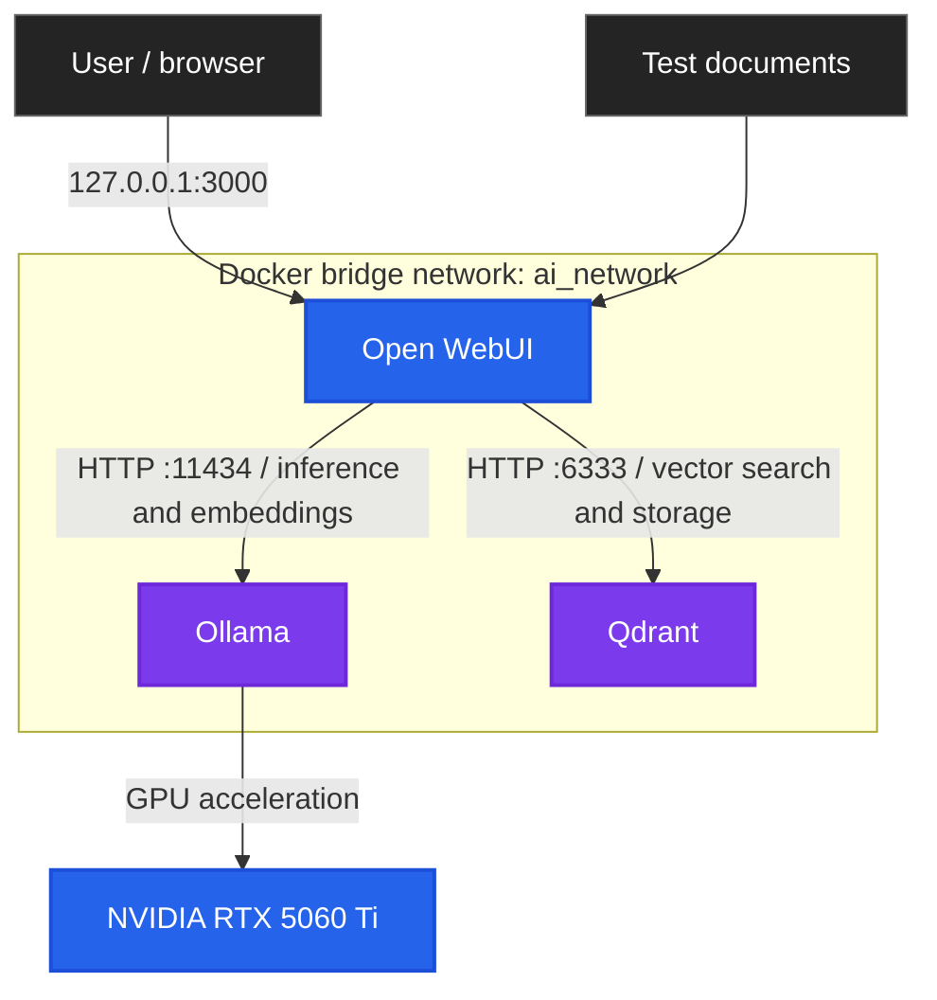

# System Architecture

## Overview

The Local AI Security Lab runs three containerised services on Kali Linux: **Open WebUI** for interaction and document retrieval, **Ollama** for local model inference and embeddings, and **Qdrant** for vector storage. Docker Compose coordinates the services on a shared bridge network, while NVIDIA Container Toolkit provides GPU access to Ollama.

This document describes the **initial implementation verified in the lab**, not a production-hardened deployment.

## Architecture Diagram

The embedding model runs **through Ollama**, not as a fourth container. The diagram shows service-level connections; it does not claim that the bridge network prevents all container-to-container or outbound communication.

## Components and Responsibilities

| Component | Responsibility |
|---|---|
| Kali Linux 2026.3 | Host operating system |
| Docker Engine and Compose | Container orchestration and persistent resources |
| NVIDIA Container Toolkit | GPU access for the Ollama container |
| Ollama | Local language model inference and embedding generation |
| Open WebUI | Browser interface, document processing and RAG coordination |
| Qdrant | Vector storage and similarity search |
| `embeddinggemma-2:740m` | Document and query embeddings, served by Ollama |
| `qwen3.5:9b` | Language model used for the documented RAG tests |

A Gemma model was also tested for GPU inference; the documented RAG retrieval workflow used Qwen.

## Network Boundaries

All three services share a Docker Compose bridge network named `ai_network`. Compose created the network as `local-ai-security-lab_ai_network` in the tested environment; the actual name depends on the Compose project name.

| Service | Container port | Host publication |
|---|---:|---|
| Open WebUI | 8080 | `127.0.0.1:3000` only |
| Ollama | 11434 | Not published |
| Qdrant | 6333 | Not published |

Open WebUI connects to `http://ollama:11434` and `http://qdrant:6333` by Docker service name. A port not published to the host **may still be reachable from containers on the same network**. This deployment did not configure API-key authentication for Qdrant.

## RAG Data Flow

**Indexing:** A test document is uploaded through Open WebUI, processed into chunks, embedded by `embeddinggemma-2:740m` via Ollama, and stored as vectors in Qdrant.

**Retrieval:** Open WebUI embeds a question, retrieves relevant chunks from Qdrant and supplies the retrieved context to `qwen3.5:9b` for response generation. Retrieval improves access to source material but does not guarantee factual accuracy or resistance to prompt injection.

The documented tests used a private, synthetic network-forensics document. They verified specific information retrieval, interpretation of the retrieved context and acknowledgement of an absent SHA-256 hash in the tested case.

## Persistent Storage

| Docker volume | Purpose |
|---|---|
| `ollama_data` | Downloaded models |
| `open_webui_data` | Application settings, documents and knowledge-base data |
| `qdrant_data` | Vector collections and storage |

The lab verified that the relevant data remained available after container restarts. **A complete backup-and-restore exercise has not yet been completed.**

## Security Design and Limitations

The initial configuration restricted Open WebUI's published port to host loopback, did not publish Ollama or Qdrant ports, and stored the Open WebUI secret outside the Compose file in a protected `.env` file. The test knowledge base was private.

These are baseline controls, **not a complete security assessment**. Additional work remains for Qdrant authentication, advanced container hardening, prompt-injection assessment, network isolation review, reproducible performance measurements and full volume recovery testing.

## Validation Scope

The documented lab checks covered container-to-container connectivity, Ollama GPU inference, vector storage and RAG retrieval, host port exposure, and persistence after restart. The corresponding screenshots are held in the project's original Obsidian evidence collection and will be linked from the public repository after review.

## References

- [Docker Compose networking](https://docs.docker.com/compose/how-tos/networking/)
- [Docker port publishing](https://docs.docker.com/engine/network/port-publishing/)
- [NVIDIA Container Toolkit](https://docs.nvidia.com/datacenter/cloud-native/container-toolkit/latest/)
- [Ollama documentation](https://docs.ollama.com/)
- [Open WebUI documentation](https://docs.openwebui.com/)
- [Qdrant documentation](https://qdrant.tech/documentation/)
