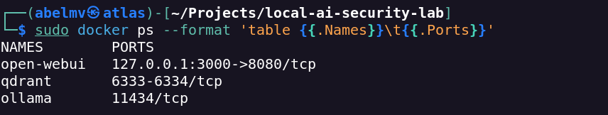
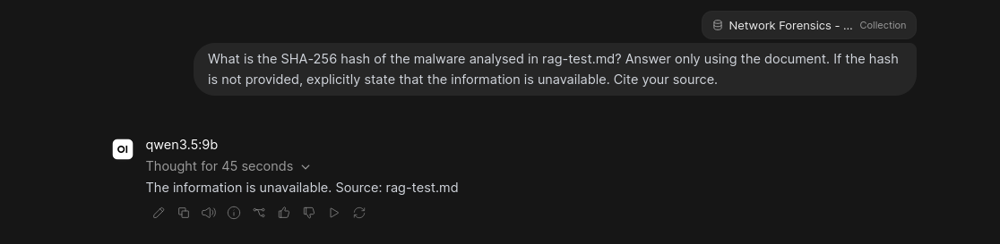

# Security Assessment

## Scope

This document records the security controls and limitations observed during the **initial Local AI Security Lab deployment** on Kali Linux. The assessment covered host port exposure, Docker service boundaries, handling of configuration secrets, access to Docker, and selected risks associated with retrieval-augmented generation (RAG).

**Assessment boundary:** This was a configuration review with functional verification, **not** a penetration test, complete image vulnerability audit, or production security certification. Identified gaps are design and assurance risks, not demonstrated exploits.

## Implemented Controls

| Area | Recorded implementation | Assessment |
| --- | --- | --- |
| Web interface | Open WebUI bound to `127.0.0.1:3000` | Port exposure verified |
| Internal APIs | Ollama and Qdrant have no published host ports | Port exposure verified |
| Container networking | Dedicated Compose bridge network, `ai_network` | Implemented; not complete network isolation |
| Configuration secrets | `WEBUI_SECRET_KEY` stored in `.env` with file permissions `600` | Permissions verified |
| Version control | Real `.env` excluded through `.gitignore`; placeholder `.env.example` used | Recorded in lab configuration |
| Docker administration | Docker commands run with `sudo`; user not added to the `docker` group | Implemented |
| GPU access | NVIDIA GPU assigned to Ollama rather than all services | Verified in deployment |
| Knowledge base | Private collection containing synthetic test material | Implemented |
| Data storage | Separate named Docker volumes for each service | Persistence after restart verified |

These measures reduce exposure but do not establish that the system is hardened against all threats.

## Network Exposure

The Compose configuration publishes only the web interface to the host loopback address:

```yaml
ports:
  - "127.0.0.1:3000:8080"
```

The services communicate over `ai_network` using Docker DNS names such as `ollama` and `qdrant`.

| Service | Internal port(s) | Host publication |
| --- | --- | --- |
| Open WebUI | `8080` | `127.0.0.1:3000` |
| Ollama | `11434` | None |
| Qdrant | `6333`, `6334` | None |

The recorded verification command was:

```bash
sudo docker ps --format 'table {{.Names}}\t{{.Ports}}'
```

**Evidence E10 — Container port exposure:**



*Docker reports Open WebUI bound to `127.0.0.1:3000`; Ollama and Qdrant have no published host ports.*

**Boundary limitation:** Not publishing a port to the host does **not** prevent communication from other containers attached to the same Docker network. Outbound traffic was not explicitly restricted. Qdrant API-key authentication was **not** configured; its accessibility therefore depends on the network and host access controls.

## Secrets and Privileged Access

Open WebUI uses `WEBUI_SECRET_KEY` supplied via `.env`. The secret was generated locally from cryptographically secure random bytes, and the file was restricted to its owner:

```bash
chmod 600 .env
stat -c '%a %n' .env
```

The recorded permission check returned `600 .env`. The actual secret must **never** be committed, included in screenshots, or copied into example files. Use a placeholder in `.env.example` and keep `.env` excluded through `.gitignore`.

Docker administration required `sudo`. The lab did not add the regular user to the `docker` group or run its services with `--privileged`. This does not eliminate the high privilege of the Docker daemon or establish comprehensive container hardening.

## RAG Security Considerations

The RAG workflow uses a private test knowledge base, local inference and manual comparison of answers against a synthetic source document. These choices limit the initial data exposure, but retrieved text remains **untrusted input** to the language model.

| Risk | Potential impact | Test status |
| --- | --- | --- |
| Indirect prompt injection | Malicious instructions embedded in retrieved documents | Not tested |
| Knowledge-base poisoning | Manipulated source material influencing answers | Not tested |
| Data leakage | Disclosure of private document content | Not tested |
| Unsupported or hallucinated answers | Incorrect assertions presented without evidence | One limited functional test |
| Unauthorised service access | Interaction with internal APIs by an unintended client | Network configuration reviewed; no adversarial access test |

### Missing-information test

In test **T09**, the model was asked for a malware SHA-256 hash that was absent from the source document. It stated that the information was unavailable instead of inventing a hash.

**Evidence E09 — RAG missing-information test:**



*The model explicitly indicated that the requested SHA-256 hash was unavailable in the supplied document.*

This is evidence of appropriate behaviour for **one test question**, not proof of general hallucination resistance or prompt-injection resilience.

## Findings and Recommended Improvements

| Finding | Security implication | Recommended next step | Status |
| --- | --- | --- | --- |
| Mutable Docker tags (`latest`, `main`) | Deployments may change without deliberate review | Pin tested versions or image digests | Pending |
| Qdrant without API authentication | Any client reaching the API may be able to interact with it | Evaluate API-key authentication and stricter network boundaries | Pending |
| Limited container hardening | Compromise may have greater effect than necessary | Review capabilities, privileges, read-only filesystems and resource constraints | Pending |
| No documented image vulnerability assessment | Known package or image vulnerabilities may go undetected | Scan and review container images | Pending |
| No complete volume restore test | Backups may not be sufficient for recovery | Back up and restore all three service volumes | Pending |
| No adversarial RAG testing | Injection and content manipulation risks remain unassessed | Design controlled prompt-injection and poisoning tests | Pending |
| Limited continuous monitoring | Failures or misuse may go unnoticed | Introduce proportionate logs, metrics and alerts | Pending |

These findings are **identified limitations**, not confirmed exploited vulnerabilities. Changes should be tested before being described as implemented.

## Assessment Outcome

The initial deployment demonstrated local-only web port publication, no published Ollama or Qdrant host ports, protected configuration file permissions, functional Docker/GPU integration, and a limited missing-information RAG test. It remains a **learning and research environment** with further security validation required before considering broader network exposure or production use.

## References

- [Docker Engine security](https://docs.docker.com/engine/security/)
- [Docker port publishing](https://docs.docker.com/engine/network/port-publishing/)
- [OWASP Top 10 for LLM Applications](https://genai.owasp.org/llm-top-10/)
- [Qdrant security documentation](https://qdrant.tech/documentation/security/)
- [Open WebUI documentation](https://docs.openwebui.com/)
