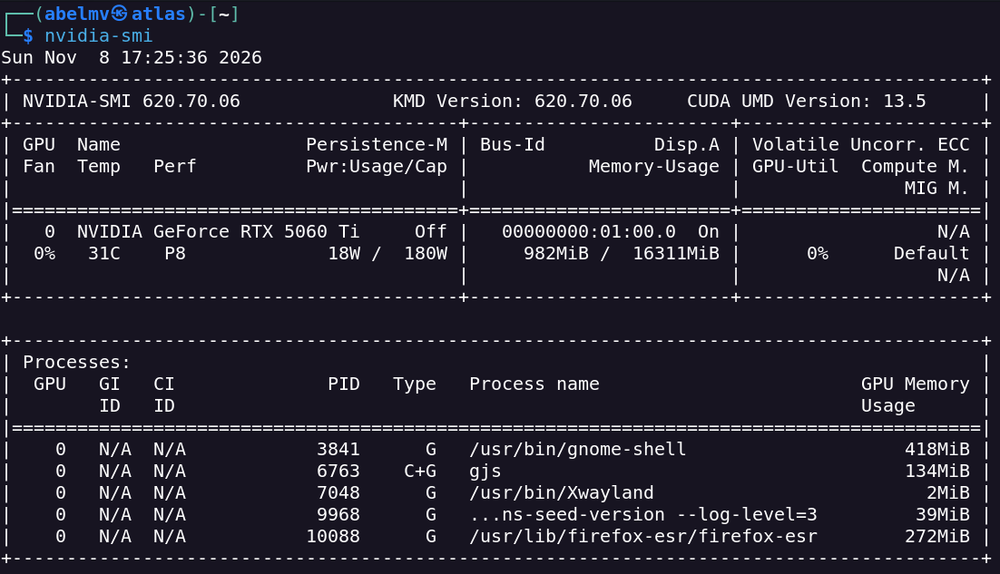
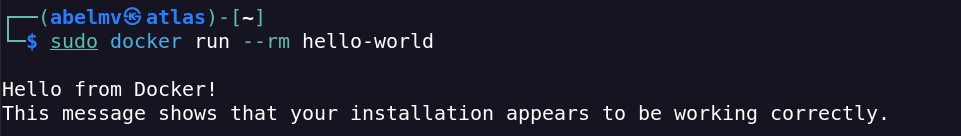
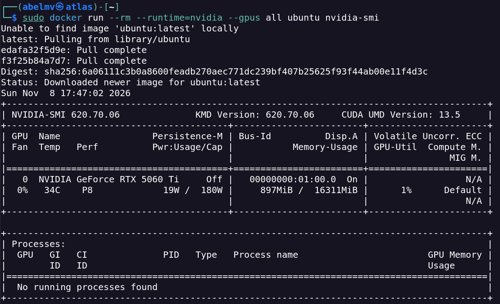
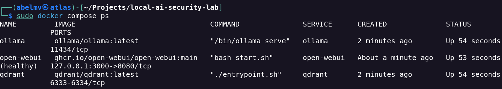
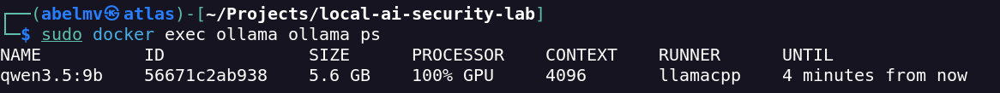
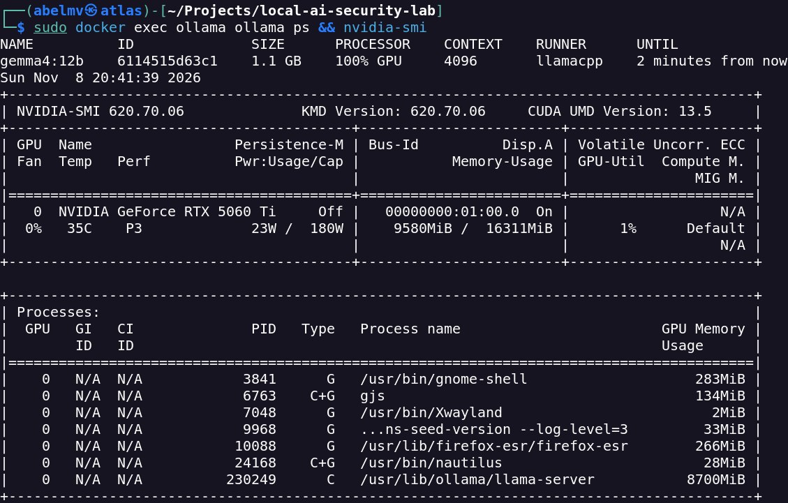
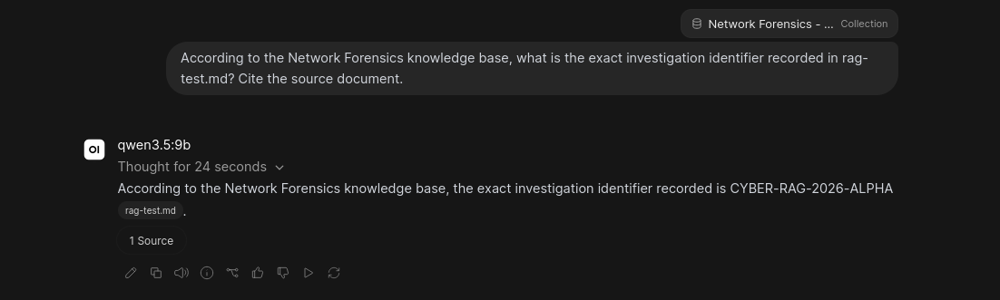
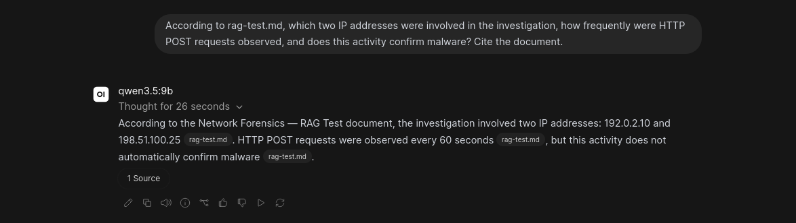
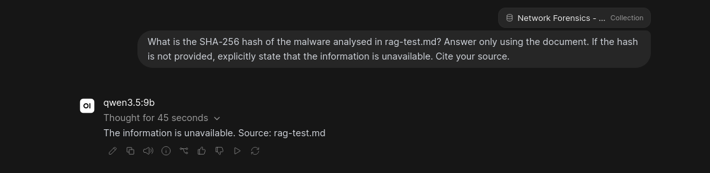
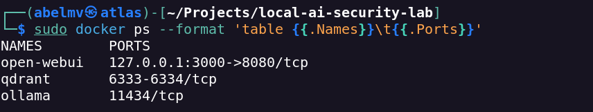

# Validation and Test Evidence

## Scope

This document records the **initial functional validation** of the Local AI Security Lab deployed on Kali Linux. Ten tests (T01–T10) cover the host GPU, Docker, containerised NVIDIA access, service deployment, model inference, retrieval-augmented generation (RAG) and host port exposure.

The screenshots are direct evidence of the observed test runs. The results do **not** constitute a benchmark, penetration test or comprehensive AI security assessment.

## Test Environment

| Component | Configuration |
| --- | --- |
| Operating system | Kali GNU/Linux 2026.3 |
| GPU | NVIDIA GeForce RTX 5060 Ti, 16 GB |
| Container platform | Docker Engine and Docker Compose |
| GPU integration | NVIDIA Container Toolkit |
| Inference service | Ollama |
| User interface | Open WebUI |
| Vector database | Qdrant |
| Models tested | `qwen3.5:9b`, `gemma4:12b` |
| Embedding model | `embeddinggemma-2:740m` |
| RAG test material | Synthetic `rag-test.md` in the private `Network Forensics - RAG Test` knowledge base |

## Test Summary

| Test | Validation | Recorded outcome | Evidence |
| --- | --- | --- | --- |
| T01 | NVIDIA driver detection | Passed | [E01](#t01--nvidia-driver-detection) |
| T02 | Docker Engine execution | Passed | [E02](#t02--docker-engine-execution) |
| T03 | NVIDIA GPU access inside Docker | Passed | [E03](#t03--nvidia-container-integration) |
| T04 | Three-service container deployment | Passed | [E04](#t04--container-deployment) |
| T05 | Qwen GPU inference | Passed | [E05](#t05--qwen-gpu-inference) |
| T06 | Gemma GPU inference | Passed | [E06](#t06--gemma-gpu-inference) |
| T07 | Exact-information RAG retrieval | Passed | [E07](#t07--exact-information-retrieval) |
| T08 | Network forensics contextual interpretation | Passed | [E08](#t08--network-forensics-interpretation) |
| T09 | Handling of information absent from the source | Passed for the tested question | [E09](#t09--missing-information-handling) |
| T10 | Container host port exposure | Verified against intended configuration | [E10](#t10--container-port-exposure) |

## Infrastructure Validation

### T01 — NVIDIA Driver Detection

**Objective:** Confirm that Kali Linux detects the NVIDIA GPU and its driver.

```bash
nvidia-smi
```

**Observed result:** The RTX 5060 Ti was detected, with driver version `620.70.06` recorded in the test notes.

**Evidence E01 — Host NVIDIA verification**



### T02 — Docker Engine Execution

**Objective:** Confirm that Docker can start and run a test container.

```bash
sudo docker run --rm hello-world
```

**Observed result:** Docker returned its successful `hello-world` confirmation.

**Evidence E02 — Docker Engine verification**



### T03 — NVIDIA Container Integration

**Objective:** Confirm that a Docker container can access the GPU through the NVIDIA runtime.

```bash
sudo docker run --rm --runtime=nvidia --gpus all ubuntu nvidia-smi
```

**Observed result:** `nvidia-smi` detected the NVIDIA GPU inside the container.

**Evidence E03 — Container GPU access**



### T04 — Container Deployment

**Objective:** Verify that the three application services are running.

```bash
sudo docker compose ps
```

**Observed result:** Ollama, Open WebUI and Qdrant were operational in the initial deployment.

**Evidence E04 — Service status**



## Model and GPU Validation

### T05 — Qwen GPU Inference

**Objective:** Check whether the `qwen3.5:9b` model uses GPU acceleration during inference.

```bash
sudo docker exec ollama ollama ps
```

**Observed result:** Ollama reported GPU execution for the Qwen model.

**Evidence E05 — Qwen inference**



### T06 — Gemma GPU Inference

**Objective:** Confirm GPU activity while running `gemma4:12b`.

```bash
nvidia-smi
```

**Observed result:** GPU activity and VRAM consumption were observed while Gemma was running.

**Evidence E06 — Gemma GPU verification**



These checks demonstrate observed GPU use, **not** comparative inference performance or sustained throughput.

## RAG Validation

The RAG tests used a private Open WebUI knowledge base called `Network Forensics - RAG Test`, containing a **synthetic** source document, `rag-test.md`. The checks evaluated the answers against specific facts provided in that document.

### T07 — Exact-Information Retrieval

**Objective:** Retrieve an exact identifier included in the test document.

**Expected result:** `CYBER-RAG-2026-ALPHA`.

**Observed result:** The model returned the identifier and displayed a document source reference.

**Evidence E07 — RAG retrieval**



### T08 — Network Forensics Interpretation

**Objective:** Retrieve and interpret network-related information from the synthetic incident description without claiming that malware was confirmed.

**Expected result:** Identify the recorded IP addresses, destination port and periodic activity, while distinguishing indicators from conclusive findings.

**Observed result:** The response identified the recorded facts and retained the uncertainty about malicious activity.

**Evidence E08 — Contextual RAG validation**



### T09 — Missing-Information Handling

**Objective:** Check whether the model invents a malware SHA-256 hash absent from the source document.

**Expected result:** State that the hash is not provided in the available source.

**Observed result:** The model indicated that the hash was unavailable rather than supplying an invented value.

**Evidence E09 — Missing-information test**



**Interpretation:** This is one successful missing-information test. It does **not** demonstrate general hallucination resistance, accuracy across other documents or resilience to prompt injection.

## Network Exposure Validation

### T10 — Container Port Exposure

**Objective:** Compare Docker's published ports with the intended local-only service design.

```bash
sudo docker ps --format 'table {{.Names}}\t{{.Ports}}'
```

**Expected configuration:** Open WebUI published at `127.0.0.1:3000`; no host ports published for Ollama or Qdrant.

**Observed result:** The published ports matched this configuration.

**Evidence E10 — Host port exposure**



**Security boundary:** An unpublished host port is not equivalent to full service isolation; containers on the same Docker network may still communicate with internal APIs.

## Additional Checks

The project notes record these supplementary verifications; they do **not** have separate E11+ screenshots.

| Check | Recorded result |
| --- | --- |
| Docker Compose configuration validation | Passed |
| Open WebUI connectivity to Ollama | Passed |
| Qdrant API connectivity | Passed |
| Embedding generation | 768-dimensional vectors |
| Qdrant knowledge collection | Six vector points |
| Data persistence after restarting services | Passed |
| Configuration backup integrity comparison | SHA-256 comparison passed |

The configuration backup check did **not** include a full Docker volume restore.

## Limitations and Next Steps

This initial test campaign did not include inference speed or latency benchmarks, systematic RAG accuracy measurement, adversarial prompt-injection testing, container image vulnerability scanning, complete volume recovery, or prolonged load and availability tests.

The ten recorded tests establish a working baseline for further hardening and security research; they should not be interpreted as production readiness.

## Related Documentation

- [Project overview](../README.md)
- [Architecture](architecture.md)
- [Deployment guide](deployment.md)
- [Security assessment](security.md)
